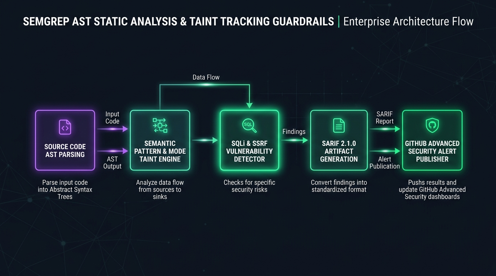

# Semgrep AST Policy Guardrails Studio

[](https://github.com/Pradeeptalari14/tp-semgrep-ast-guardrails/actions)
[](LICENSE)
[](https://talaripradeep.info/tools/semgrep-ast-guardrails/)
[](https://talaripradeep.info/studios/flow/?studio=semgrep-ast-guardrails)

> **Author:** [Talari Pradeep](https://talaripradeep.info) — Senior SRE & Platform Architect  
> **Interactive Studio Workspace:** [https://talaripradeep.info/tools/semgrep-ast-guardrails/](https://talaripradeep.info/tools/semgrep-ast-guardrails/)  
> **Visual Flow Canvas DAG:** [https://talaripradeep.info/studios/flow/?studio=semgrep-ast-guardrails](https://talaripradeep.info/studios/flow/?studio=semgrep-ast-guardrails)  
> **Documentation Guide:** [https://talaripradeep.info/tools/semgrep-ast-guardrails/learn.html](https://talaripradeep.info/tools/semgrep-ast-guardrails/learn.html)

---

## 1. System Architecture Flow



### Architectural Highlights
Author custom Semgrep AST static analysis policies, taint tracking rules for SQL injection and SSRF, and automated SARIF publishing to GitHub Security tab.

* **Cryptographic Provenance:** Guarantees tamper-proof software supply chain attestation before deployment.
* **Deterministic Policy Gates:** Continuous enforcement against unauthorized container digests, bad dependencies, or untrusted inputs.
* **Zero Static Secrets:** Ephemeral identity validation avoiding long-lived bastion credentials.

---

## 2. Infrastructure & Software Technology Stack

| Category | Technology | Architectural Role |
| :--- | :--- | :--- |
| **Static Analysis** | `Semgrep OSS 1.80+`, `Tree-Sitter AST Parser`, `Interprocedural Taint Mode` | Enterprise verification & telemetry |
| **Vulnerability Coverage** | `OWASP Top 10 (A01 - A10)`, `CWE-89 SQL Injection`, `CWE-918 Server-Side Request Forgery` | Enterprise verification & telemetry |
| **Security CI/CD** | `GitHub Code Scanning SARIF`, `Pre-Commit Git Hooks`, `SonarQube Quality Gates` | Enterprise verification & telemetry |

---

## 3. Primary Specification Manifest: `semgrep-rules.yml`

```yaml
rules:
  - id: detect-tainted-sql-injection
    languages: [python, javascript, go]
    severity: ERROR
    message: "Untrusted user input directly concatenated into SQL query"
    mode: taint
    pattern-sources:
      - pattern: request.args.get(...)
      - pattern: req.query[...]
    pattern-sinks:
      - pattern: db.execute(...)
      - pattern: cursor.execute(...)
```

---

## 4. Quickstart & Local Verification

### A. Clone and Validate
```bash
git clone https://github.com/Pradeeptalari14/tp-semgrep-ast-guardrails.git
cd tp-semgrep-ast-guardrails

# Execute SRE validation drill
chmod +x scripts/validate.sh
./scripts/validate.sh
```

### B. Run Implementation Automation
```bash
python3 main.py
```

---

## 5. Kubernetes & Docker Deployment

### Docker Run
```bash
docker build -t tp-semgrep-ast-guardrails:latest .
docker run --rm tp-semgrep-ast-guardrails:latest
```

### Kubernetes Admission Policy
```yaml
apiVersion: v1
kind: ConfigMap
metadata:
  name: semgrep-guardrails-config
data:
  semgrep-rules.yml: |
    rules:
      - id: block-insecure-tls
        languages: [python, go]
        severity: ERROR
        message: "TLS InsecureSkipVerify must not be enabled"
        pattern: "InsecureSkipVerify: true"
```

---

## 6. SRE Runbook & Operational Verification

* **Verify Signatures & Telemetry:**
  ```bash
  cosign verify --certificate-identity-regexp '.*@github\.com' ghcr.io/pradeep/service:latest
  ```
* **Audit Rekor Transparency Log:**
  ```bash
  rekor-cli search --sha <IMAGE_SHA256_HASH>
  ```

---

## 7. License

Licensed under the [MIT License](LICENSE). Copyright (c) 2026 Talari Pradeep.
